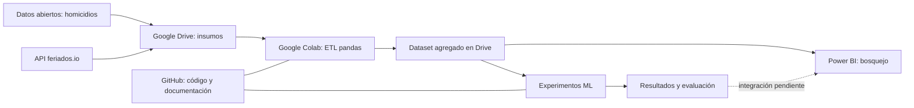

# LOAModel | Análisis espacio-temporal de homicidios en Ecuador

Proyecto Integrador de Ingeniería en Sistemas de la Información, Universidad Internacional del Ecuador (UIDE). **Estado: prototipo académico en desarrollo**, documentación actualizada al 24/11/2026. Repositorio de código, experimentos y entregables; no es un sistema de alerta operativa ni un producto comercial desplegado.

## Objetivo y alcance

Analizar patrones históricos de víctimas de homicidios intencionales mediante datos oficiales y variables de calendario, evaluar modelos de aprendizaje automático y comunicar resultados agregados mediante un dashboard preliminar de Power BI. La unidad del pipeline vigente es **provincia–distrito–fecha–franja horaria**. El Avance I utiliza cantón–día; LSTM agrega a distrito–día. No son unidades equivalentes. El proyecto no identifica personas ni determina incidentes individuales ni tasas de riesgo poblacional.

El histórico abarca 2014–2025 y un archivo independiente de enero–agosto de 2026. **ECU 911 fue descartado** según la Fase 2 de Ciberseguridad, p. 3; las menciones antiguas corresponden al alcance inicial. La API de feriados sí fue consultada e integrada. El dashboard es un **bosquejo**, no su versión final.

## Estructura y navegación

| Carpeta | Contenido |
|---|---|
| [01_Gestion_del_Proyecto](01_Gestion_del_Proyecto/) | Objetivo, alcance, sprint y criterios de aceptación |
| [02_Datos_Big_Data](02_Datos_Big_Data/) | Fuentes oficiales, API, notebook de calendario y rutas de Drive |
| [03_Procesamiento](03_Procesamiento/) | ETL vigente, EDA y preparación histórica |
| [04_Modelos_ML](04_Modelos_ML/) | AdaBoost, Random Forest, LSTM, Avance II y antecedentes |
| [05_Resultados](05_Resultados/) | Exportaciones históricas y guía de resultados actuales |
| [06_Dashboard](06_Dashboard/) | Informe de Semana 7 y bosquejo del dashboard |
| [07_Documentacion](07_Documentacion/) | Tendencias, modelo de negocio, reproducibilidad y ciberseguridad |

## Flujo tecnológico

Jira y WhatsApp se utilizan para organización y comunicación, según la Fase 2. Secrets de Colab custodia la credencial de feriados. No hay evidencia de despliegue en AWS/Azure, ni de un `.pbix` publicado en este ZIP.

## Estado de avances verificados

| Componente | Evidencia guardada | Estado |
|---|---|---|
| API de feriados | 173 registros para 2014–2026, salida de notebook | Ejecutada; CSV fuente en Drive |
| ETL | 45.497 registros combinados; 45.492 válidos para agregación (5 sin hora válida); 2.590.560 unidades y 12 columnas exportadas | Ejecutado según salidas guardadas |
| Big Data | pandas implementado; Polars y PySpark considerados | Comparativa de motores pendiente |
| Avance I | Regresión lineal y logística, granularidad cantón–día | Histórico; no solución definitiva |
| Avance II | Regresión logística, árbol de decisión y SVM lineal | Comparación de tres clases ejecutada |
| AdaBoost | Regresión y clasificación binaria por franja | Experimento ejecutado |
| Random Forest | Clasificación baja/media/alta por franja | Experimento ejecutado; umbral explorado sobre test |
| LSTM | Regresión y clasificación binaria diarias, ventanas de 28 días | Experimento ejecutado |
| Dashboard | Informe de Semana 7 | Bosquejo; implementación/validación pendientes |
| Seguridad | Fases 2 y 3, controles CTL-01 a CTL-06 | Estado según informes; validación de Fase 4 pendiente |

Las cifras son de salidas existentes, no de una nueva ejecución. **AdaBoost, Random Forest y LSTM son los enfoques principales documentados; no hay ganador comparable ni selección operativa certificada.** Ver [modelos](04_Modelos_ML/README.md) y [resultados](05_Resultados/README.md).

## Reproducción

1. Abrir los notebooks en Colab y montar la cuenta autorizada de Drive. No se requiere mover los archivos de Drive por la reorganización del GitHub.
2. Colocar los Excel originales en `ModelLOA/Datos_Iniciales/` con sus nombres originales (ver [fuentes](02_Datos_Big_Data/Homicidios/README.md)).
3. Configurar el Secret `API_Feriados` en Colab solo para el [notebook de feriados](02_Datos_Big_Data/Calendario/Feriados.ipynb). Su código guarda actualmente el CSV en `00_Proyecto_Sexto/Datos_Iniciales/`; copiar el resultado a `ModelLOA/Datos_Iniciales/` antes del ETL, o ajustar la ruta manualmente según el Drive del equipo.
4. Ejecutar [Procesamiento_DatasetModelo](03_Procesamiento/Procesamiento_DatasetModelo.ipynb); verificar las salidas y que exista `ModelLOA/Datos_Procesados/dataset_homicidios_final.csv`.
5. Ejecutar los notebooks de [modelos](04_Modelos_ML/) según el objetivo. Consultar sus cortes y métricas antes de comparar. Los artefactos exportados por AdaBoost y LSTM están previstos en Drive; no se incluyeron como archivos independientes en el ZIP.
6. Para el dashboard, consumir únicamente tablas revisadas y agregadas. La conexión definitiva, las métricas de usabilidad y las pruebas con usuarios siguen pendientes.

Dependencias principales: Python, pandas, numpy, openpyxl, matplotlib, seaborn, scikit-learn, requests, joblib y TensorFlow para LSTM. [requirements.txt](requirements.txt) es una lista orientativa sin versiones fijadas; registrar las versiones efectivamente utilizadas para una reproducción exacta. Los Excel y el CSV final no se distribuyen aquí; no se ha comprobado la ejecución completa en este entorno.

## Limitaciones y uso responsable

El dataset vigente tiene 98,61 % de ceros, completados bajo el supuesto de ausencia de registros en combinaciones no observadas. Las clases minoritarias requieren métricas por clase. No comparar directamente resultados de distintas unidades, fechas, objetivos ni protocolos. Separar ajuste, validación y prueba; fijar categorías con datos de entrenamiento y revisar disponibilidad temporal. Las predicciones son experimentales, no una justificación automática de asignación de recursos ni afirmaciones causales.

## Documentación y seguridad

- [Semana 7: dashboard y valor](06_Dashboard/README.md) (10–16/11/2026).
- [Product Owner: tendencias y modelo de negocio](07_Documentacion/Tendencias_y_Modelo_de_Negocio/README.md).
- [Ciberseguridad: Fases 2 y 3](07_Documentacion/Ciberseguridad/README.md). Las copias públicas reservan correos, firmas y evidencias personales; los originales deben permanecer en Drive restringido.
- [Limitaciones y reproducibilidad](07_Documentacion/Reproducibilidad/README.md).
- [Seguridad y publicación](SECURITY.md) y [registro de reorganización](CHANGELOG.md).
- [Cómo aplicar la actualización en GitHub](ACTUALIZAR_GITHUB.md).

## Integrantes

| Integrante | GitHub |
|---|---|
| Oscar Lara | os-devsec |
| Liseth Simbaña | chadowsv |
| Anthony Pilamunga | anthqny |

Fuente de datos: [Portal de datos abiertos de Ecuador](https://www.datosabiertos.gob.ec/dataset/homicidios-intencionales). API: [documentación interna](02_Datos_Big_Data/API_feriados.md). Consultar condiciones de uso de las fuentes antes de redistribuir datos. No se ha añadido una licencia al proyecto sin acuerdo del equipo.
